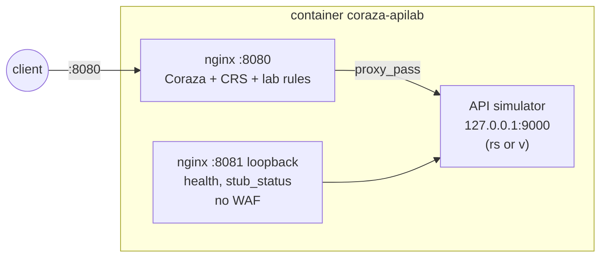
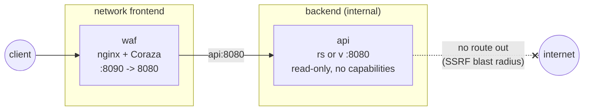
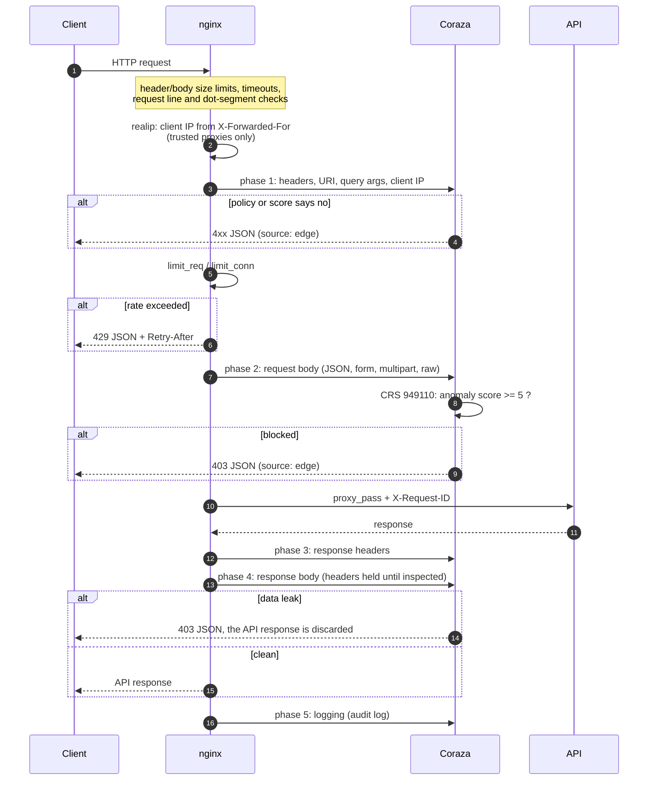
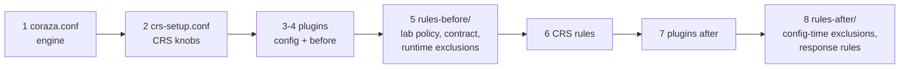

# coraza-apilab

A working, tested lab of [OWASP Coraza](https://coraza.io) WAF inside nginx, protecting a simulated corporate API. Every rule is commented with what it does, why, and in which order it runs, and every rule has an end-to-end test that proves both the status code the client gets and whether the request reached the API.

The protected API is one of two interchangeable simulators with the same contract: [rs-http-apilab](https://github.com/Esl1h/rs-http-apilab) (Rust/axum) or [v-http-apilab](https://github.com/Esl1h/v-http-apilab) (V/veb). Their `/lab/calls` endpoint records every request that arrives, which turns "the WAF blocked it" from an assumption into evidence.

Two layouts are provided:

- **all-in-one**: nginx, Coraza and the API binary in a single container.
- **split**: the WAF and the API in separate containers, the API on an internal network with no published port and no internet access.

> Lab material. It is meant to be read, run, broken and tuned. The rules are realistic, but production use needs your own traffic, your own tuning and a review of the trust settings flagged in the comments (notably `set_real_ip_from`).

## Contents

- [Quick start](#quick-start)
- [Architecture](#architecture)
- [What protects what: layers](#what-protects-what-layers)
- [Rule organization and load order](#rule-organization-and-load-order)
- [The test suite: proof of arrival](#the-test-suite-proof-of-arrival)
- [Tuning workflow and false positives](#tuning-workflow-and-false-positives)
- [Lessons learned building it](#lessons-learned-building-it)
- [Limitations](#limitations)
- [Versions](#versions)
- [Repository layout](#repository-layout)
- [Em português (resumo)](#em-português-resumo)

Full rule catalog: [docs/rules.md](docs/rules.md).

## Quick start

Requirements: Docker with Compose v2, `make`, `curl`, `bash`; `jq` for `make explain-*`. The images download pinned, checksum-verified releases, so the first build needs internet and takes a few minutes (it compiles libcoraza and the nginx module).

```sh
make allinone-up            # all-in-one on http://localhost:8080 (Rust API)
make test-allinone          # 184 checks: statuses + proof of arrival + rate limits
make explain-allinone       # which rule decided each test case (audit log)

make split-up               # split layout on http://localhost:8090
make test-split

APILAB=v make allinone-up   # same thing with the V simulator
make down
```

Try it by hand:

```sh
curl -s localhost:8080/api/v1/users/1                       # 200, reaches the API
curl -s "localhost:8080/api/v1/search?q=1'+UNION+SELECT+1--" # 403, CRS SQLi
curl -s localhost:8080/api/v1/users/abc                     # 400, @restpath contract
curl -s localhost:8080/.env                                 # 404, never existed
curl -s localhost:8080/lab/response-marker                  # 403, data leak caught in the response
```

Errors produced at the edge use the API's error envelope plus `"source":"edge"`, so you can tell who answered:

```json
{"error":{"code":"waf_blocked","message":"request blocked by the WAF","source":"edge","request_id":"5617d4e0..."}}
```

The same `request_id` is in the nginx access log, in the Coraza audit log (it is the transaction id) and in the API log (sent as `X-Request-ID`).

## Architecture

### All-in-one



`docker/allinone-entrypoint.sh` starts the API as an unprivileged user, waits for it to be healthy, then starts nginx; if either process exits, the container exits and the restart policy brings both back. The API port is never published.

### Split



The `backend` network is `internal`: the API cannot reach the internet and nothing outside Docker can reach the API. This is the shape you would deploy (two services, or a WAF sidecar in the same pod).

### Life of a request



## What protects what: layers

A WAF is one layer. This lab keeps every control where it works best and documents who answers each case:

| Concern | Layer | Where |
| --- | --- | --- |
| Slow clients (slowloris, slow POST) | nginx timeouts | `nginx/nginx.conf` |
| Oversized headers and request line | nginx buffers (400/414) | `nginx/nginx.conf` |
| Body above 8 MiB | nginx `client_max_body_size` (413) | `nginx/nginx.conf` |
| Body above 2 MiB | Coraza `SecRequestBodyLimit` (413) | `coraza/coraza.conf` |
| Body above 1 MiB | API `MAX_BODY_BYTES` (413, API envelope) | simulator |
| Real client IP behind a proxy | nginx realip | `nginx/nginx.conf` |
| Rate limiting, brute force | nginx `limit_req`/`limit_conn` (429) | `nginx/nginx.conf` |
| IP reputation, admin ACL, Host, methods | Coraza lab rules | `coraza/rules-before/1[01]0-*` |
| API contract (paths, params, types, schemas) | Coraza lab rules | `coraza/rules-before/140-*` |
| Generic attacks (SQLi, XSS, RCE, LFI, SSRF...) | OWASP CRS, anomaly scoring | `coraza/crs-setup.conf` |
| Data leaks in responses | Coraza lab rules + CRS 95x | `coraza/rules-after/910-*` |
| Authentication itself | the API | simulator |

Why rate limiting is in nginx: Coraza v3 has no persistent collections (`initcol` is accepted but does nothing), so a rule cannot count requests across transactions. CRS's DoS plugin depends on exactly that and does not work on Coraza.

## Rule organization and load order

`coraza/main.conf` is the single file nginx loads. Order matters: Coraza runs phase by phase (1 request headers, 2 request body, 3 response headers, 4 response body, 5 logging) and, inside a phase, in load order.



| Step | File | Purpose |
| --- | --- | --- |
| 1 | `coraza.conf` | Body access, parsers per Content-Type, size and argument limits, response inspection, audit log |
| 2 | `crs-setup.conf` | Paranoia (block PL1, detect PL2), threshold 5, early blocking, allowed methods, Content-Types, HTTP versions, argument limits |
| 3-4 | `plugins/*-config.conf`, `*-before.conf` | CRS [referer-hardening](https://github.com/coreruleset/referer-hardening-plugin) plugin |
| 5 | `rules-before/100..160` | Lab rules, cheapest and most certain first: who is calling, sane protocol, User-Agent, URI, API contract, credentials, payload |
| 5 | `rules-before/190-runtime-exclusions.conf` | `ctl:` exclusions that must run before the CRS rule they change |
| 6 | `crs/rules/*.conf` | OWASP CRS 4.25 LTS |
| 7 | `plugins/*-after.conf` | Plugin rules that need CRS results |
| 8 | `rules-after/900-config-exclusions.conf` | `SecRuleRemoveById`/`UpdateTargetById`: act on already-loaded rules, so they come last |
| 8 | `rules-after/910-response.conf` | Phase 3 and 4: canary DLP, secrets in responses, observability |

Each rule in the lab files follows the same template:

```apache
# 10400 | phase 1 | deny 400
# /api/v1/users/{id}: positive integer, at most 9 digits.
SecRule REQUEST_FILENAME "@restpath /api/v1/users/{id}" \
    "id:10400,\
    phase:1,\
    deny,\
    status:400,\
    log,\
    t:none,\
    msg:'Invalid user id in path',\
    logdata:'id=%{ARGS_PATH.id}',\
    tag:'lab/api-contract',\
    tag:'lab/positive-model',\
    severity:'ERROR',\
    chain"
    SecRule ARGS_PATH:id "!@rx ^[1-9][0-9]{0,8}$" \
        "t:none"
```

Two decision styles are shown on purpose:

- **Hard policy (`deny`)**: certain facts that need no second opinion (denylisted IP, route not in the inventory, wrong Content-Type, schema violation).
- **Anomaly scoring (`pass` + `setvar`)**: weak signals that only matter together. Rules 10220 (no User-Agent, +3) and 10230 (no Accept, +2) pass alone and block together, because CRS rule 949110 blocks at a total of 5. Same mechanism CRS uses for every attack rule.

Coraza-specific operators used: `@restpath` (path templates into `ARGS_PATH`) and `@validateSchema` (JSON Schema, with `additionalProperties:false` against mass assignment).

## The test suite: proof of arrival

`tests/waf-test.sh` sends 91 requests (legitimate and malicious), each labeled with a unique `X-Test-Case` header, then reads the simulator's `/lab/calls` buffer:

- blocked at the edge: status matches AND the case is **absent** from the API buffer AND the body says `"source":"edge"`;
- allowed: status matches AND the case is **present**;
- blocked in the response phase (data leak): the case is **present** (the API answered) but the client got 403.

```text
PASS case-026-ip-denylist                         status 403
PASS case-071-crs-sqli                            status 403
PASS case-090-canary-in-body                      status 403
...
PASS case-026-ip-denylist                         reached API: no
PASS case-090-canary-in-body                      reached API: yes
PASS login burst (10 in a row) ->  401 401 401 401 401 401 429 429 429 429
== 184 passed, 0 failed
```

Client IPs are simulated with `X-Forwarded-For` (nginx trusts the Docker networks as a proxy in this lab), so the same suite exercises the denylist, the admin ACL, the trusted scanner and per-IP rate limits.

`tests/explain.sh` (`make explain-allinone CASE=...`) reads the JSON audit log and shows which rules decided each case:

```text
case-044-no-ua-no-accept  status=403
    10220  Request without User-Agent
    10230  Request without Accept header
    920320  Missing User Agent Header
    949110  Inbound Anomaly Score Exceeded (Total Score: 5)
```

(920320 is a CRS paranoia level 2 rule: with detection at PL2 and blocking at PL1 it is logged but adds nothing to the blocking score.)

## Tuning workflow and false positives

The workflow the repository encodes, and the one to follow in production:

1. Deploy with `SecRuleEngine DetectionOnly` (or a high anomaly threshold) and real traffic.
2. Read the audit log: every would-be block, with rule id, variable and value.
3. For each false positive, write the narrowest exclusion: one route, one rule, one argument.
4. Add a test case for the legitimate request and for the attack the rule still has to catch.
5. Switch to `On`; lower the threshold step by step.

A real false positive found by this suite: the `body-1.5m-api` case got a 403 instead of the API's 413. The audit log showed CRS 920450 ("HTTP header is restricted by policy (/expect/)"): curl sends `Expect: 100-continue` before bodies over 1 MiB, and CRS treats `Expect` as a restricted header. The fix (rule 10900) removes only the `Expect` header from rule 920450, only when its value is exactly `100-continue`, only on the two routes that receive large bodies.

Runtime (`ctl:ruleRemoveTargetById`, in `rules-before/190`) versus configure-time (`SecRuleUpdateTargetById`, in `rules-after/900`) exclusions: the first depends on the request and must run before the target rule; the second applies to every request and must be loaded after the target rule exists.

## Lessons learned building it

Material for the presentation; each item cost at least one broken run.

1. **`nginx -t` does not validate Coraza rules.** coraza-nginx compiles the rules inside each worker after fork (a Go runtime does not survive fork). A broken rule passes `nginx -t`, then every worker dies and requests hang with the master still "up". The lab compiles `docker/coraza-check.c` (20 lines against libcoraza) and runs it from `/docker-entrypoint.d/` and `make check`, so a bad rule fails fast with the parser's message.
2. **A relative glob `Include` silently matches nothing.** `Include crs/rules/*.conf` loaded 19 rules instead of 700 and raised no error. `main.conf` uses absolute paths, and `coraza-check` prints the rule count.
3. **libcoraza 1.8.0 bundles Coraza 3.7.0.** Coraza 3.8.1 is a security release (JSON nesting crash, multipart strict-error and `t:jsDecode` bypasses, among others) and adds `SecArgumentsLimit`. The Dockerfile bumps the engine with `go get` before building libcoraza.
4. **One plugin crashed the WAF.** The CRS referer-hardening plugin uses `setvar:'!tx.1'` (variable removal). In Coraza 3.8.1 that dereferences a nil pointer (`internal/actions/setvar.go`) and the Go panic aborts the nginx worker: any request with a `Referer` header killed a worker. Workaround in `rules-after/900`; the `referer` test is the regression check. A WAF is code in the request path; test it with your real plugins and headers.
5. **Not every CRS plugin runs on Coraza.** auto-decoding uses `t:sqlHexDecode` (not implemented), fake-bot needs Lua, dos-protection needs persistent collections.
6. **Unknown body types are parsed as urlencoded.** CRS forces body inspection and Coraza falls back to the URLENCODED parser: a 1 MiB binary upload became thousands of garbage arguments, hit `SecArgumentsLimit`, and cost about 10 s per MiB. Rule 200007 selects the RAW processor for `application/octet-stream` and `text/plain`.
7. **Custom scoring rules in phase 1 lose their points.** CRS rule 901200 resets the anomaly scores in phase 1, after the lab's phase 1 rules ran. Scoring rules are phase 2.
8. **The audit log missed the WAF's own 404s.** `SecAuditLogRelevantStatus` excludes 404 (API noise), so the sensitive-file rules force `ctl:auditEngine=On`.
9. **Go RE2, not PCRE.** No lookahead, no backreferences: `^(?:5|4(?!04))` had to be spelled out.
10. **Files created by root at startup break the workers.** The first `coraza-check` ran as root and created the debug log; the `nginx` workers could not open it. The check runs as the worker user.
11. **Memory is per worker.** Each nginx worker holds its own compiled WAF: 80 to 105 MiB RSS per worker in this lab, with CRS and the per-location `coraza_rules` override (one more WAF instance per worker). `worker_processes` is set to 2, not `auto` (a 24-core host would otherwise start 24 copies).
12. **The audit log is sensitive.** Part B (request headers) includes `Authorization`. The lab drops the body of the login route from the audit record (rule 10530), but the log still needs the access control you would give credentials.

## Limitations

- **No cross-request state in Coraza** (see above): rate limiting and brute-force protection are nginx's job.
- **No GeoIP**: `@geoLookup` needs a geo database plugin compiled into libcoraza; not included.
- **Upstream DNS**: in the split layout nginx resolves `api` at startup. If the API container gets a new IP, reload nginx (or use `resolve` with a `resolver` on `upstream` servers).
- **Response inspection costs latency**: the response headers are held until the body is inspected. `/lab/stream` turns it off per location, which also shows the per-location `coraza_rules` override.
- **Performance**: about 2 ms of added latency per small request and roughly 0.7 s per MiB for large raw bodies inspected by CRS, measured on the lab machine. Measure on yours.
- **Trust settings**: `set_real_ip_from` trusts all private ranges so the tests can choose client IPs. In production it must list only your load balancers.

## Versions

| Component | Version | Pinning |
| --- | --- | --- |
| nginx | 1.30.5 (official image, Debian trixie) | image tag + source tarball sha256 |
| coraza-nginx | v0.22.0 | tarball sha256 |
| libcoraza | v1.8.0 | tarball sha256 |
| Coraza engine | v3.8.1 | `go get`, verified against sum.golang.org |
| Go (build only) | 1.26.9 | image tag |
| OWASP CRS | v4.25.2 (LTS) | tarball sha256 |
| CRS referer-hardening plugin | commit 3f3120d | tarball sha256 |
| rs-http-apilab | v1.0.0 release binary | sha256 |
| v-http-apilab | v1.0.0 release binary | sha256 |

Bump a version by changing its `ARG` pair (version and sha256) in the `Dockerfile`; the build fails if the checksum does not match.

## Repository layout

```text
coraza-apilab/
├── Dockerfile                      targets: waf, api, allinone (multi-stage, pinned)
├── Makefile                        up/down/test/explain/check
├── docker/
│   ├── allinone-entrypoint.sh      runs API + nginx, exits if either dies
│   ├── coraza-check.c              rule-set validator (libcoraza)
│   └── 05-coraza-check.sh          runs the validator before nginx starts
├── nginx/
│   ├── nginx.conf                  module, realip, rate limits, logs, timeouts
│   ├── templates/default.conf.template   upstream, locations, loopback probe port
│   └── snippets/                   proxy settings, JSON edge errors
├── coraza/
│   ├── main.conf                   load order (start here)
│   ├── coraza.conf                 engine
│   ├── crs-setup.conf              CRS tuning
│   ├── rules-before/               lab rules 100..190 (before CRS)
│   ├── rules-after/                exclusions and response rules (after CRS)
│   ├── data/                       IP lists, User-Agent lists
│   └── schemas/                    JSON Schemas for @validateSchema
├── examples/
│   ├── allinone/compose.yml
│   └── split/compose.yml
├── tests/
│   ├── waf-test.sh                 end-to-end suite with proof of arrival
│   └── explain.sh                  audit log: which rules decided each case
└── docs/rules.md                   rule catalog
```

## Em português (resumo)

Laboratório funcional e testado do WAF [OWASP Coraza](https://coraza.io) dentro do nginx, protegendo uma API corporativa simulada ([rs-http-apilab](https://github.com/Esl1h/rs-http-apilab) em Rust ou [v-http-apilab](https://github.com/Esl1h/v-http-apilab) em V). Cada regra está comentada (o que faz, por que existe e em que ordem roda) e tem um teste ponta a ponta que confere o status recebido pelo cliente e se a requisição chegou ou não na API, usando o buffer `/lab/calls` do simulador como prova.

Dois exemplos:

- **all-in-one**: nginx, Coraza e o binário da API no mesmo container (`make allinone-up`, porta 8080);
- **split**: WAF e API em containers separados, com a API numa rede interna sem porta publicada e sem saída para a internet (`make split-up`, porta 8090).

```sh
make allinone-up && make test-allinone     # 184 verificações
make explain-allinone CASE=no-ua-no-accept        # quais regras decidiram o caso
APILAB=v make split-up && make test-split  # com o simulador em V
```

As regras seguem a ordem documentada pelo CRS e vão do mais barato e certo ao mais caro: origem (denylist de IP, ACL de rotas administrativas, scanner autorizado em DetectionOnly), protocolo (Host, quantidade e duplicidade de headers, método por rota), User-Agent (ferramentas de ataque, bibliotecas no login e um exemplo de pontuação de anomalia), URI (tamanho, encoding, arquivos sensíveis, inventário de rotas, allowlist de estáticos), contrato da API (`@restpath`, limites de query, Content-Type por rota, JSON Schema contra mass assignment), credenciais (só Bearer, formato do token, rotas que exigem token), payload (introspecção e batching de GraphQL, SSRF, upload, SSTI), CRS 4.25 LTS com pontuação de anomalia e, na resposta, DLP com canário e detecção de segredos. Rate limit fica no nginx, porque o Coraza v3 não tem coleções persistentes.

A seção [Lessons learned](#lessons-learned-building-it) reúne o que quebrou durante a construção (validação de regras que o `nginx -t` não faz, `Include` relativo com glob que não carrega nada, plugin que derruba o worker, corpo binário tratado como urlencoded, falso positivo com `Expect: 100-continue`) e serve de roteiro para a apresentação e para o post. O catálogo completo das regras está em [docs/rules.md](docs/rules.md).
