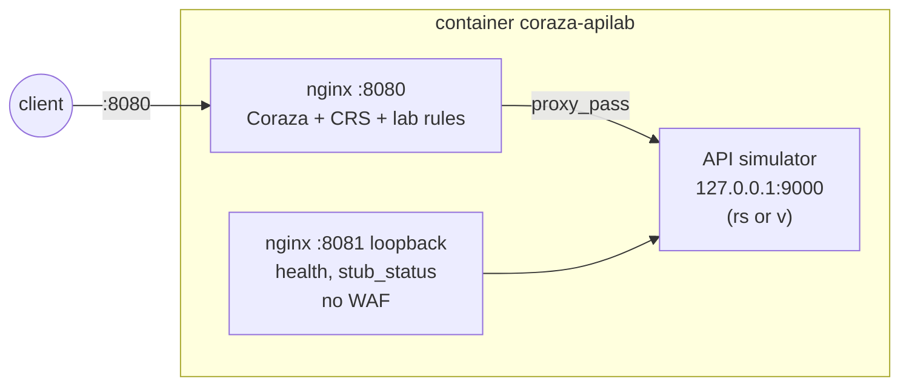
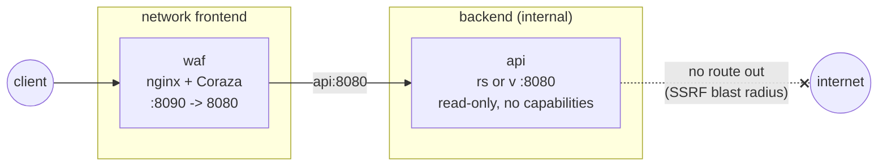
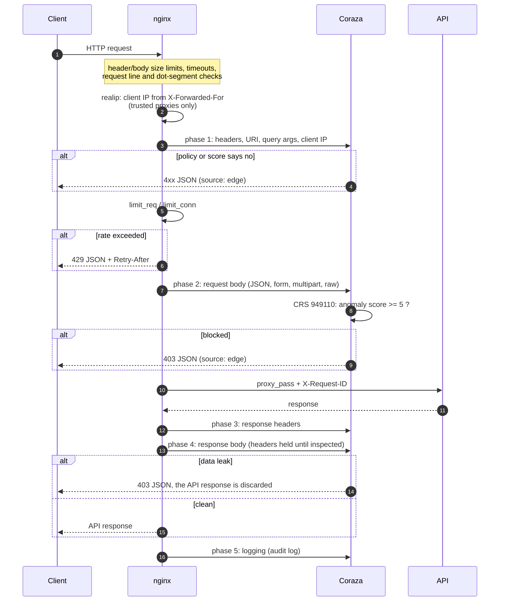
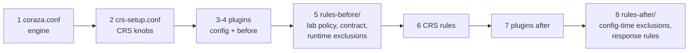
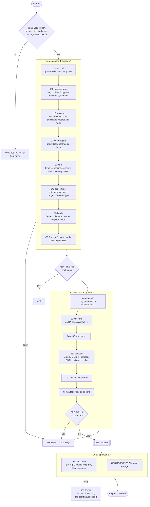

# WAF de verdade na frente de uma API de mentira: um laboratório de Coraza + nginx + OWASP CRS

Todo mundo concorda que uma API exposta precisa de um WAF. Pouca gente consegue responder, com evidência, duas perguntas simples: "essa requisição foi bloqueada por qual regra?" e "ela chegou ou não chegou no backend?". Este post descreve um laboratório que responde as duas, regra por regra, com testes automatizados.

O lab tem três peças:

1. um **simulador de API** determinístico, com dados sintéticos e um endpoint que prova o que chegou nele;
2. o **OWASP Coraza**, um WAF compatível com ModSecurity escrito em Go, carregado dentro do **nginx** como módulo, com o **OWASP CRS** e um plugin;
3. um conjunto de **regras próprias comentadas**, um catálogo, diagramas e uma **suíte de testes** que valida status e chegada de cada caso.

Tudo está em [github.com/Esl1h/coraza-apilab](https://github.com/Esl1h/coraza-apilab) e roda localmente com Docker.

## Índice

- [Parte 1: o simulador de API](#parte-1-o-simulador-de-api)
- [Parte 2: o Coraza](#parte-2-o-coraza)
- [Parte 3: o laboratório](#parte-3-o-laboratório)
  - [Arquitetura e diagramas](#arquitetura-e-diagramas)
  - [Rodando o all-in-one](#rodando-o-all-in-one)
  - [Rodando o split](#rodando-o-split)
  - [Ordem de carga das regras](#ordem-de-carga-das-regras)
  - [Catálogo de regras](#catálogo-de-regras)
  - [Testes: prova de chegada](#testes-prova-de-chegada)
  - [Afinando: falsos positivos reais](#afinando-falsos-positivos-reais)
  - [O que quebrou no caminho](#o-que-quebrou-no-caminho)
- [Conclusão](#conclusão)

## Parte 1: o simulador de API

Para testar um WAF você precisa de um backend que se comporte como uma API corporativa de verdade (login, CRUD, busca, upload, webhook, GraphQL, rotas administrativas), mas que não tenha nada a perder. Por isso existe o simulador, em duas implementações com o mesmo contrato:

- [rs-http-apilab](https://github.com/Esl1h/rs-http-apilab), em Rust com axum;
- [v-http-apilab](https://github.com/Esl1h/v-http-apilab), em V com veb.

As duas têm os mesmos endpoints, as mesmas variáveis de ambiente, o mesmo envelope de erro e a mesma suíte de testes em curl. Rodar o binário abre a porta na hora: sem banco, sem migração, sem arquivo de configuração. Reiniciar volta ao estado inicial.

### O que ele simula

- **Infra**: `/health`, `/ready` (forçável para 503), `/version`, `/metrics` em formato Prometheus.
- **Autenticação simulada**: `POST /api/v1/auth/login` devolve um token Bearer; `/auth/me` e `/auth/logout` exigem o token.
- **Recursos**: usuários (CRUD completo), busca, relatórios com download CSV, tickets, formulário urlencoded.
- **Integrações**: receptor de webhook (aceita qualquer Content-Type e devolve só um resumo) e um stub de GraphQL.
- **Arquivos**: upload multipart ou octet-stream (nunca grava em disco) e uma allowlist de estáticos.
- **Administração**: `/admin/status`, `/admin/config` (valida e ecoa, nunca aplica) e `/internal/debug`.
- **Utilitários de laboratório**: `/lab/echo` (reflete método, path, query e alguns headers), `/lab/slow?ms=`, `/lab/status/{code}`, `/lab/large?bytes=`, `/lab/stream`, `/lab/headers` e `/lab/response-marker`, que devolve um marcador fixo para testar inspeção de resposta.

Todo erro sai no mesmo formato:

```json
{"error":{"code":"...","message":"...","request_id":"..."}}
```

### A peça que faz o lab funcionar: `/lab/calls`

O simulador guarda em memória as últimas 200 requisições que **chegaram** nele. Basta subir com `LAB_ADMIN_TOKEN` e marcar cada requisição com um header `X-Test-Case`:

```sh
LAB_ADMIN_TOKEN=lab-secret ./rs-http-apilab-linux-amd64

curl -H 'X-Test-Case: caso-42' 'http://127.0.0.1:8080/api/v1/search?q=security'

curl -H 'X-Lab-Token: lab-secret' http://127.0.0.1:8080/lab/calls |
  jq '.calls[] | select(.x_test_case == "caso-42")'
```

Se o caso aparece no buffer, a requisição chegou no backend. Se não aparece, alguém no meio do caminho cortou: proxy, WAF, firewall, timeout. Quando o WAF fica na frente, essa ausência é a prova de que o bloqueio aconteceu de verdade.

### Baixando o binário

Os dois projetos publicam o binário em cada release, com `SHA256SUMS`:

```sh
gh release download v1.0.0 --repo Esl1h/rs-http-apilab
sha256sum -c SHA256SUMS
chmod +x rs-http-apilab-linux-amd64
LAB_ADMIN_TOKEN=lab-secret ./rs-http-apilab-linux-amd64   # 0.0.0.0:8080
```

Troque `rs` por `v` para usar a versão em V. Os binários são dinâmicos contra glibc 2.36 ou mais nova (Debian bookworm em diante).

### Obtendo o `openapi.json`

A especificação OpenAPI 3.0.3 completa vem embutida no binário e é servida em dois lugares:

- `GET /openapi.json`: o documento cru;
- `GET /docs`: Swagger UI apontando para ele (os assets da UI vêm de CDN; a API em si não depende de internet).

Para salvar o arquivo:

```sh
curl -s http://127.0.0.1:8080/openapi.json -o openapi.json
jq '.info, (.paths | keys)' openapi.json
```

O mesmo funciona através do WAF do laboratório (`http://localhost:8080/openapi.json` no all-in-one, `:8090` no split). Isso, aliás, gerou um falso positivo que vou contar mais adiante.

### Explorando com Bruno ou Restfox

Com o `openapi.json` em mãos, a melhor forma de explorar a API manualmente é importar a especificação num cliente de API. Recomendo dois, ambos open source e locais (nada de conta em nuvem para guardar suas coleções):

- [**Bruno**](https://www.usebruno.com): guarda as coleções como arquivos de texto no seu disco, então elas vão para o Git junto com o projeto. Importe em *Import Collection*, escolhendo a especificação OpenAPI (arquivo ou URL). Cada rota vira uma requisição pronta, com corpo de exemplo.
- [**Restfox**](https://restfox.dev): leve, roda como app desktop ou direto no navegador, e também importa OpenAPI. Ótimo para uma exploração rápida sem instalar nada.

Dicas para usar os dois contra o laboratório:

- Crie uma variável de ambiente `baseUrl` com `http://localhost:8080` (all-in-one) ou `http://localhost:8090` (split) e troque à vontade entre o simulador puro e o simulador atrás do WAF.
- Faça o login, copie o `token` da resposta e use como Bearer nas rotas protegidas.
- Adicione o header `X-Test-Case` nas requisições que quiser rastrear no `/lab/calls`.
- Repare que o WAF bloqueia o login quando o User-Agent é de biblioteca HTTP crua (`axios/`, `python-requests`, `Go-http-client`...), regra 10210. O Bruno se identifica como `bruno-runtime/...` e passa; se o seu cliente for barrado no login, é essa regra trabalhando.

## Parte 2: o Coraza

### O que é

O [OWASP Coraza](https://coraza.io) é um motor de WAF em Go, compatível com a linguagem de regras do ModSecurity (SecLang) e com o [OWASP CRS](https://coreruleset.org). Ele é uma biblioteca: você embute num servidor ou proxy por meio de um conector. Os conectores mais comuns são para Caddy, Envoy/Proxy-Wasm, HAProxy (SPOA) e, o que usamos aqui, **nginx**.

A cadeia no nginx tem três partes:

1. **[coraza](https://github.com/corazawaf/coraza)**: o motor em Go;
2. **[libcoraza](https://github.com/corazawaf/libcoraza)**: o motor exportado como biblioteca C compartilhada (`libcoraza.so`);
3. **[coraza-nginx](https://github.com/corazawaf/coraza-nginx)**: o módulo dinâmico do nginx que conversa com a libcoraza.

Um detalhe de arquitetura que vai importar depois: a libcoraza é carregada com `dlopen()` **dentro de cada worker, depois do fork**. Um runtime Go não sobrevive a um fork, então cada worker inicializa o seu próprio runtime e compila o seu próprio conjunto de regras.

### Como uma transação é avaliada

Cada requisição vira uma transação que passa por cinco fases:

1. **Request headers**: método, URI, query, headers, IP do cliente.
2. **Request body**: o corpo, já interpretado pelo processador certo (JSON, urlencoded, multipart, XML ou RAW).
3. **Response headers**.
4. **Response body**.
5. **Logging**: sempre roda, mesmo se houve bloqueio.

Dentro de cada fase, as regras rodam na ordem em que foram carregadas. Uma regra tem variáveis (onde olhar), um operador (o que procurar), transformações (como normalizar antes) e ações (o que fazer):

```apache
SecRule REQUEST_HEADERS:User-Agent "@pmFromFile bad-user-agents.txt" \
    "id:10200,phase:1,deny,status:403,log,t:none,t:lowercase,\
    msg:'Attack tool User-Agent',severity:'CRITICAL'"
```

### Dois jeitos de decidir: deny e pontuação de anomalia

- **Bloqueio direto (`deny`)**: a regra decide sozinha. Bom para política certa: IP na denylist, rota que não existe, Content-Type errado.
- **Pontuação de anomalia**: é o modelo do CRS. Uma regra de ataque não bloqueia; ela soma pontos (crítico 5, erro 4, aviso 3, nota 2). No fim da fase, a regra 949110 compara o total com o limite (5 por padrão) e bloqueia se passar. Um sinal forte bloqueia sozinho, vários sinais fracos somam. É isso que torna o CRS ajustável sem editar regra.

### Paranoia levels

O CRS separa as regras em níveis de paranoia (PL1 a PL4). PL1 tem poucos falsos positivos; cada nível acima pega mais coisa e exige mais ajuste. Dá para **bloquear num nível e detectar em outro**: no lab, bloqueamos em PL1 e registramos até PL2, então o audit log mostra o que subir de nível pegaria antes de você pagar pelos falsos positivos.

### Plugins do CRS

O CRS tem um mecanismo de plugins: cada plugin traz arquivos `*-config.conf`, `*-before.conf` e `*-after.conf`, carregados antes e depois das regras do CRS, numa faixa de IDs reservada (9.500.000 a 9.999.999). Há plugins de exclusão para aplicações conhecidas (WordPress, Nextcloud...), de endurecimento e de integração.

Nem todo plugin roda no Coraza. Avaliei alguns:

- **referer-hardening**: valida o header `Referer` e inspeciona as partes dele com as regras do CRS. **Usado no lab**, com um contorno que explico adiante.
- **auto-decoding**: usa `t:sqlHexDecode`, que o Coraza não implementa. Não carrega.
- **fake-bot**: depende de Lua, que o Coraza não tem.
- **dos-protection**: depende de coleções persistentes por IP.

### O que o Coraza não faz

- **Estado entre requisições**: o Coraza v3 aceita `initcol`, mas a ação não faz nada; não existem coleções persistentes. Rate limit e proteção contra força bruta ficam no nginx (`limit_req`).
- **Lua** (`SecRuleScript`).
- **GeoIP** sem um plugin de base geográfica compilado na libcoraza.
- **Regex PCRE**: o Coraza usa RE2 do Go, sem lookahead e sem backreference.

Em troca, ele tem operadores que o ModSecurity não tem e que fazem muita diferença em API:

- **`@restpath`**: casa um template de rota (`/api/v1/users/{id}`) e coloca os placeholders em `ARGS_PATH`, para validar segmento de path como argumento;
- **`@validateSchema`**: valida o corpo JSON contra um JSON Schema.

## Parte 3: o laboratório

O repositório [coraza-apilab](https://github.com/Esl1h/coraza-apilab) coloca tudo isso junto em dois formatos e documenta cada decisão. Versões usadas, todas fixadas e verificadas por sha256 no build:

- nginx 1.30.5 (imagem oficial, Debian trixie);
- coraza-nginx v0.22.0 e libcoraza v1.8.0;
- motor Coraza **v3.8.1** (a libcoraza 1.8.0 vem com o 3.7.0; o build atualiza porque o 3.8.1 é release de segurança);
- OWASP CRS v4.25.2 (linha LTS);
- plugin referer-hardening, fixado por commit;
- binários v1.0.0 do rs-http-apilab e do v-http-apilab.

### Arquitetura e diagramas

Os diagramas abaixo são os mesmos do repositório, em Mermaid; o GitHub renderiza direto. Links para as versões no repo:

- [All-in-one, split e ciclo de vida da requisição](https://github.com/Esl1h/coraza-apilab#architecture)
- [Ordem de carga das regras](https://github.com/Esl1h/coraza-apilab#rule-organization-and-load-order)
- [Fluxo de avaliação regra por regra](https://github.com/Esl1h/coraza-apilab/blob/main/docs/rules.md#how-a-request-is-evaluated)

**All-in-one**: nginx, Coraza e o binário da API no mesmo container. A API escuta em `127.0.0.1:9000` e a porta não é publicada; a única entrada é o nginx. Uma segunda porta, `8081` só em loopback, serve health check e `stub_status` sem WAF: probe de saúde nunca pode ser bloqueado por falso positivo.



**Split**: WAF e API em containers separados. A API fica só numa rede `internal: true`: sem porta publicada, sem rota para a internet (o que reduz o estrago de um SSRF) e com container read-only, sem capabilities. É o formato que você usaria em produção, como dois serviços ou como sidecar no mesmo pod.



**Ciclo de vida de uma requisição**. Repare na ordem: o nginx descarta HTTP malformado antes do Coraza; o `realip` resolve o IP real; a fase 1 do Coraza roda antes do rate limit; e a inspeção de resposta segura os headers até o corpo ser inspecionado, para conseguir trocar a resposta por um 403 se encontrar vazamento.



### Camadas: quem responde o quê

Um WAF é uma camada, não a defesa toda. O lab deixa cada controle onde ele funciona melhor:

| Problema | Quem resolve |
| --- | --- |
| Cliente lento (slowloris, slow POST) | timeouts do nginx |
| Header ou linha de requisição gigante | buffers do nginx (400/414) |
| Corpo acima de 8 MiB | `client_max_body_size` do nginx (413) |
| Corpo acima de 2 MiB | `SecRequestBodyLimit` do Coraza (413) |
| Corpo acima de 1 MiB | `MAX_BODY_BYTES` da API (413 com o envelope da API) |
| IP real atrás de proxy | `realip` do nginx |
| Rate limit, força bruta | `limit_req`/`limit_conn` do nginx (429) |
| Reputação de IP, ACL, Host, métodos | regras do lab no Coraza |
| Contrato da API | regras do lab no Coraza |
| Ataques genéricos (SQLi, XSS, RCE, LFI, SSRF...) | OWASP CRS |
| Vazamento na resposta | regras do lab + CRS 95x |
| Autenticação | a própria API |

Os três limites de tamanho são propositalmente decrescentes, para que a resposta diga quem atendeu. Toda resposta gerada na borda (nginx ou Coraza) usa o envelope da API com um campo a mais, `"source":"edge"`:

```json
{"error":{"code":"waf_blocked","message":"request blocked by the WAF","source":"edge","request_id":"5617d4e0..."}}
```

O mesmo `request_id` aparece no access log do nginx, no audit log do Coraza (é o id da transação, via `coraza_transaction_id $request_id`) e no log da API (enviado como `X-Request-ID`). Um id, três logs.

### Rodando o all-in-one

Requisitos: Docker com Compose v2, `make`, `curl` e `bash`; `jq` para o `explain`. O primeiro build baixa e compila a libcoraza e o módulo do nginx, então leva alguns minutos.

```sh
git clone https://github.com/Esl1h/coraza-apilab
cd coraza-apilab

make allinone-up            # http://localhost:8080, simulador em Rust
make test-allinone          # 184 verificações
make explain-allinone       # quais regras decidiram cada caso
make audit                  # acompanha o audit log do Coraza
make allinone-down
```

Para usar o simulador em V, basta a variável:

```sh
APILAB=v make allinone-up
```

Por dentro, o `docker/allinone-entrypoint.sh` sobe a API como usuário sem privilégio, espera ela responder e só então inicia o nginx. Se qualquer um dos dois processos morrer, o container sai e a política de restart sobe os dois de novo, em vez de deixar o nginx respondendo 502 para sempre.

Experimente na mão:

```sh
curl -s localhost:8080/api/v1/users/1                        # 200, chega na API
curl -s "localhost:8080/api/v1/search?q=1'+UNION+SELECT+1--"  # 403, SQLi pelo CRS
curl -s localhost:8080/api/v1/users/abc                      # 400, contrato via @restpath
curl -s localhost:8080/.env                                  # 404, "nunca existiu"
curl -s localhost:8080/lab/response-marker                   # 403, vazamento pego na resposta
```

### Rodando o split

```sh
make split-up               # http://localhost:8090
make test-split
make explain-split
make split-down

APILAB=v make split-up      # com o simulador em V
```

Os dois exemplos usam portas diferentes (8080 e 8090) e podem rodar ao mesmo tempo. `make down` derruba os dois. Para conferir o isolamento da rede interna:

```sh
docker exec coraza-apilab-api curl -s -m3 https://example.com   # falha: sem saída
```

### Ordem de carga das regras

O nginx carrega um único arquivo, [`coraza/main.conf`](https://github.com/Esl1h/coraza-apilab/blob/main/coraza/main.conf), que fixa a ordem documentada pelo CRS:



1. [`coraza.conf`](https://github.com/Esl1h/coraza-apilab/blob/main/coraza/coraza.conf): como inspecionar. Acesso ao corpo, processador por Content-Type (JSON, XML, RAW para binário e texto), limites de tamanho e de argumentos, profundidade de JSON (32), inspeção de resposta, audit log em JSON.
2. [`crs-setup.conf`](https://github.com/Esl1h/coraza-apilab/blob/main/coraza/crs-setup.conf): bloqueio em PL1, detecção em PL2, limite de anomalia 5, early blocking, métodos, Content-Types e versões HTTP permitidos, limites de argumentos dimensionados pelo contrato da API.
3. e 4. Plugins: configuração e regras "before".
5. [`rules-before/`](https://github.com/Esl1h/coraza-apilab/tree/main/coraza/rules-before): as regras do lab, da mais barata e certa para a mais cara, e as exclusões em tempo de execução (`ctl:`), que precisam rodar antes da regra do CRS que alteram.
6. CRS.
7. Plugins "after".
8. [`rules-after/`](https://github.com/Esl1h/coraza-apilab/tree/main/coraza/rules-after): exclusões em tempo de configuração (`SecRuleRemoveById` e afins só funcionam sobre regras já carregadas) e regras de resposta.

Toda regra do lab segue o mesmo modelo de comentário: ID, fase, ação, o que faz e por quê.

```apache
# 10400 | phase 1 | deny 400
# /api/v1/users/{id}: positive integer, at most 9 digits.
SecRule REQUEST_FILENAME "@restpath /api/v1/users/{id}" \
    "id:10400,\
    phase:1,\
    deny,\
    status:400,\
    log,\
    t:none,\
    msg:'Invalid user id in path',\
    logdata:'id=%{ARGS_PATH.id}',\
    tag:'lab/api-contract',\
    tag:'lab/positive-model',\
    severity:'ERROR',\
    chain"
    SecRule ARGS_PATH:id "!@rx ^[1-9][0-9]{0,8}$" \
        "t:none"
```

### Catálogo de regras

O catálogo completo, em inglês, está em [docs/rules.md](https://github.com/Esl1h/coraza-apilab/blob/main/docs/rules.md). Aqui vai o resumo comentado, na ordem em que o Coraza avalia. A coluna "Teste" é o nome do caso na suíte.

Este é o fluxo completo de avaliação, também do repositório:



#### 100: quem está falando ([100-edge-network.conf](https://github.com/Esl1h/coraza-apilab/blob/main/coraza/rules-before/100-edge-network.conf))

Decisões que dependem só do IP e da rota. São baratas e rodam primeiro.

| ID | Ação | O que faz | Teste |
| --- | --- | --- | --- |
| 10000 | deny 403 | IP na denylist (`data/ip-denylist.txt`) | `ip-denylist` |
| 10010 | engine off | `GET/HEAD /health` e `/ready` sem query pulam o WAF; vem depois da denylist, então IP banido não ganha nem probe | `health` |
| 10020 | deny 403 | `/admin`, `/internal`, `/metrics` e `/lab/calls` só da rede administrativa (a "VPN" 10.10.0.0/16) | `admin-from-internet`, `admin-from-vpn` |
| 10030 | DetectionOnly | IP do scanner autorizado: tudo é inspecionado e registrado, nada é bloqueado. Um pentest gera achados no audit log em vez de uma parede de 403 | `trusted-scanner-sqli` |

O IP vem do `realip` do nginx a partir do `X-Forwarded-For`. No lab o nginx confia nas faixas privadas para que os testes possam escolher o IP de origem. **Em produção, `set_real_ip_from` lista só os seus balanceadores**; confiar numa faixa que o cliente alcança deixa qualquer um escolher o próprio IP e passar por cima de allowlist, denylist e rate limit.

#### 110: o HTTP faz sentido para esta API ([110-protocol.conf](https://github.com/Esl1h/coraza-apilab/blob/main/coraza/rules-before/110-protocol.conf))

| ID | Ação | O que faz | Teste |
| --- | --- | --- | --- |
| 10100 | deny 400 | Host que a API não atende (cache poisoning, reset de senha envenenado, roteamento para vhost interno) | `host-not-served` |
| 10110 | deny 400 | Mais de 40 headers | `too-many-headers` |
| 10120 | deny 400 | Content-Type, Authorization ou Host duplicados: o WAF pode olhar o primeiro e o backend usar o último | `duplicate-content-type` |
| 10130 | deny 405 | PUT, PATCH e DELETE fora das rotas que aceitam | `delete-on-reports` |

O CRS complementa com a allowlist global de métodos (911100, `PROPFIND` vira 403), versões HTTP (920430, HTTP/1.0 vira 403) e Content-Types (920420). `TRACE` nem chega no Coraza: o próprio nginx devolve 405.

#### 120: quem diz estar falando ([120-user-agent.conf](https://github.com/Esl1h/coraza-apilab/blob/main/coraza/rules-before/120-user-agent.conf))

| ID | Ação | O que faz | Teste |
| --- | --- | --- | --- |
| 10200 | deny 403 | Ferramentas de ataque que não estão na lista do CRS (ffuf, hydra, patator, katana...) | `scanner-ffuf` |
| 10210 | deny 403 | User-Agent padrão de biblioteca HTTP, **só na rota de login** | `library-on-login`, `library-elsewhere` |
| 10220 | +3 pontos | Sem User-Agent | `no-user-agent` |
| 10230 | +2 pontos | Sem Accept | `no-accept`, `no-ua-no-accept` |

O par 10220 e 10230 é o exemplo didático de pontuação de anomalia: cada um sozinho passa (3 e 2 pontos, abaixo do limite 5); juntos somam 5 e o CRS bloqueia na regra 949110. Detalhe importante: as duas são de **fase 2**. A regra 901200 do CRS zera as pontuações na fase 1, depois que o arquivo do lab já rodou; pontos somados na fase 1 antes do CRS simplesmente somem.

#### 130: o que está sendo pedido ([130-uri.conf](https://github.com/Esl1h/coraza-apilab/blob/main/coraza/rules-before/130-uri.conf))

Modelo positivo aplicado a paths: em vez de listar URLs ruins (impossível), descrever as que existem.

| ID | Ação | O que faz | Teste |
| --- | --- | --- | --- |
| 10300 | deny 414 | URI acima de 2048 bytes | `uri-too-long` |
| 10310 | deny 400 | `%2f`, `%5c` ou dupla codificação no path (bypass de ACL e traversal) | `encoded-slash` |
| 10320 | deny 404 | Arquivos sensíveis: `.git`, `.env`, backups, dumps, chaves | `dotgit`, `backup-file` |
| 10330 | deny 404 | Rota fora do inventário da API | `dotenv`, `not-in-inventory` |
| 10340 | deny 404 | Nome em `/static/` fora da allowlist | `static-not-allowed` |

Por que 404 e não 403: um 403 confirma "tem algo aqui e está protegido"; um 404 não dá nada para o scanner seguir. A regra 10330 é, sozinha, a mais eficiente contra varredura cega, e ainda funciona como documentação do inventário: rota nova que não for declarada ali fica inacessível.

#### 140: o contrato da API ([140-api-contract.conf](https://github.com/Esl1h/coraza-apilab/blob/main/coraza/rules-before/140-api-contract.conf))

É aqui que o WAF deixa de ser "assinaturas genéricas" e vira um fiscal do contrato: o que estiver fora do OpenAPI é recusado, exista ou não uma assinatura para aquele ataque.

| ID | Ação | O que faz | Teste |
| --- | --- | --- | --- |
| 10400 a 10403 | deny 400 | `@restpath` para `/users/{id}`, `/tickets/{id}`, `/reports/{id}/download` e `/lab/status/{code}`, validando o formato de cada segmento | `user-id-not-numeric`, `user-id-sqli`, `report-id-format`, `status-code-format` |
| 10410, 10411 | deny 400 | Busca: `q` até 100 caracteres, `limit` de 1 a 50 | `search-q-too-long`, `search-limit-range` |
| 10420 | deny 400 | `/lab/slow?ms=` acima de 2000 (DoS de lógica de negócio: a API aceita 10 s) | `slow-above-cap` |
| 10421 | deny 400 | `/lab/large?bytes=` acima de 256 KiB (amplificação) | `large-above-cap` |
| 10430 a 10432 | deny 415 | Content-Type por rota: JSON, formulário, upload | `json-route-wrong-ct`, `form-route-wrong-ct`, `upload-wrong-ct` |
| 10440 a 10442 | deny 400 | `@validateSchema` nos corpos de criação de usuário, ticket e login | `mass-assignment`, `role-not-in-enum`, `ticket-too-many-tags`, `login-extra-field` |

Os [JSON Schemas](https://github.com/Esl1h/coraza-apilab/tree/main/coraza/schemas) usam `additionalProperties: false`. É a defesa de borda contra **mass assignment** (OWASP API3:2023): um `{"name":"x","is_admin":true}` morre no WAF antes de o backend ter a chance de vincular um campo inesperado.

Repare que `user-id-sqli` (`/api/v1/users/1 OR 1=1`) é bloqueado pela regra de contrato, não pela de SQLi: o id simplesmente não é um inteiro. Modelo positivo pega ataque sem precisar reconhecê-lo.

#### 150: credenciais ([150-auth.conf](https://github.com/Esl1h/coraza-apilab/blob/main/coraza/rules-before/150-auth.conf))

O WAF não autentica ninguém; isso é trabalho da API. Ele recusa credencial malformada cedo e mantém segredos fora do próprio log.

| ID | Ação | O que faz | Teste |
| --- | --- | --- | --- |
| 10500 | deny 401 | Esquema diferente de Bearer (Basic, NTLM...) | `basic-auth` |
| 10510 | deny 401 | Token Bearer fora do alfabeto do RFC 6750 ou do tamanho esperado; o log registra só o tamanho | `bearer-malformed` |
| 10520 | deny 401 | `/auth/me` e `/auth/logout` sem Authorization | `me-without-token` |
| 10530 | ctl | Remove o corpo da requisição do audit log na rota de login (senhas) | |

#### 160: o que vem dentro ([160-payload.conf](https://github.com/Esl1h/coraza-apilab/blob/main/coraza/rules-before/160-payload.conf))

O CRS já cobre as classes genéricas. Estas regras cobrem ataques específicos às funcionalidades desta API.

| ID | Ação | O que faz | Teste |
| --- | --- | --- | --- |
| 10600 | deny 403 | Introspecção de GraphQL (`__schema`, `__type`) | `graphql-introspection` |
| 10610 | deny 403 | Batching de aliases no GraphQL (mais de 20) | `graphql-aliases` |
| 10620 | deny 403 | SSRF: URL para loopback, RFC 1918, link-local, IPv6 local ou esquema não HTTP em webhook e `/admin/config` | `ssrf-private`, `ssrf-metadata` |
| 10630 | deny 403 | Upload com extensão executável ou de script | `upload-php` |
| 10640 | deny 403 | Sintaxe de template (`{{ }}`, `${ }`, `<% %>`) em texto livre de ticket e feedback | `ssti-ticket` |
| 10650 | deny 403 | Campos de privilégio (`role`, `is_admin`...) em `/admin/config` | `admin-config-role` |

E os casos que ficam com o CRS: SQLi (942xxx, inclusive libinjection), XSS (941xxx), RCE (932xxx), LFI (930xxx), prototype pollution (934130), Log4Shell (944xxx), scanner conhecido (913100) e o `Referer` inválido do plugin (9524110).

#### 190 e 900: exclusões ([190-runtime-exclusions.conf](https://github.com/Esl1h/coraza-apilab/blob/main/coraza/rules-before/190-runtime-exclusions.conf), [900-config-exclusions.conf](https://github.com/Esl1h/coraza-apilab/blob/main/coraza/rules-after/900-config-exclusions.conf))

| Regra | O que faz |
| --- | --- |
| 10900 | `Expect: 100-continue` nas rotas de upload e webhook deixa de ser header restrito para a 920450 |
| 10910 | `GET /openapi.json` não passa pela regra de canário 19100 |
| `SecRuleRemoveById 9524139` | Contorno de um crash do Coraza com o plugin referer-hardening |

As três têm história, contada abaixo.

#### 910: o que a API devolve ([910-response.conf](https://github.com/Esl1h/coraza-apilab/blob/main/coraza/rules-after/910-response.conf))

| ID | Fase | Ação | O que faz | Teste |
| --- | --- | --- | --- | --- |
| 19100 | 4 | deny 403 | Marcador canário `LAB_RESPONSE_MARKER_7f3a` no corpo da resposta | `canary-in-body` |
| 19110 | 3 | log | O mesmo canário em header: só registra (padrão "detecção antes de bloquear") | `canary-in-body` |
| 19120 | 4 | deny 403 | Chave privada ou access key da AWS no corpo da resposta | `secret-in-body` |
| 19130 | 3 | log | 5xx do backend (observabilidade) | `backend-503` |
| 19140 | 3 | log | Resposta não JSON numa rota `/api/v1` | |

O canário é a ideia mais útil para levar para produção: plante um registro falso e único no banco (um usuário, um cartão de teste) e bloqueie qualquer resposta que o contenha. Se ele aparecer, alguém está despejando dados que não deveria. No teste `canary-in-body`, a API responde (o caso aparece no `/lab/calls`), mas o cliente recebe 403.

### Testes: prova de chegada

A suíte [`tests/waf-test.sh`](https://github.com/Esl1h/coraza-apilab/blob/main/tests/waf-test.sh) manda 91 requisições, legítimas e maliciosas, cada uma com um `X-Test-Case` único. Depois lê o `/lab/calls` e confere, caso a caso:

- **bloqueado na borda**: o status bate, o caso **não** está no buffer da API e o corpo diz `"source":"edge"`;
- **permitido**: o status bate e o caso **está** no buffer;
- **bloqueado na resposta**: o caso **está** no buffer (a API respondeu), mas o cliente levou 403.

No fim, dois testes de rate limit: dez logins seguidos do mesmo IP (o sétimo em diante leva 429) e 80 requisições seguidas para a zona geral.

```text
== 110 protocol
PASS case-031-host-not-served                     status 400
...
== proof of arrival: /lab/calls
PASS case-026-ip-denylist                         reached API: no
PASS case-090-canary-in-body                      reached API: yes
== rate limiting (nginx limit_req; Coraza has no cross-request state)
PASS login burst (10 in a row) ->  401 401 401 401 401 401 429 429 429 429
PASS general burst (80 in a row) -> 25 x 429
== 184 passed, 0 failed
```

Os IPs de origem são simulados com `X-Forwarded-For`: cada caso usa um IP próprio de 192.0.2.0/24 (para os limites por IP não se misturarem), e os casos de ACL usam 10.10.1.5 (rede administrativa), 10.10.99.10 (scanner autorizado) e 203.0.113.7 (denylist).

Rodando:

```sh
make test-allinone                                 # contra :8080
make test-split                                    # contra :8090
BASE_URL=http://localhost:8080 VERBOSE=1 tests/waf-test.sh   # mostra o corpo de cada resposta
```

E para saber **qual regra** decidiu cada caso, o [`tests/explain.sh`](https://github.com/Esl1h/coraza-apilab/blob/main/tests/explain.sh) lê o audit log em JSON:

```sh
make explain-allinone CASE=no-ua-no-accept
```

```text
case-044-no-ua-no-accept  status=403
    10220  Request without User-Agent
    10230  Request without Accept header
    920320  Missing User Agent Header
    949110  Inbound Anomaly Score Exceeded (Total Score: 5)
```

A 920320 é uma regra de PL2 do CRS: como detectamos em PL2 e bloqueamos em PL1, ela aparece no log mas não soma na pontuação de bloqueio. É o "o que PL2 pegaria" funcionando.

### Escrevendo uma regra nova

O ciclo que o repositório incentiva:

1. Escreva a regra no arquivo da etapa certa, com o comentário no modelo (ID, fase, ação, por quê).
2. `make check`: compila o conjunto de regras com a libcoraza da imagem, sem subir o nginx, e mostra a contagem de regras.
3. Adicione dois casos em `tests/waf-test.sh`: o ataque que a regra deve pegar e a requisição legítima mais parecida que ela **não** pode pegar.
4. `make allinone-up && make test-allinone`, depois `make explain-allinone CASE=...` para confirmar que foi a sua regra que decidiu, e não outra por acidente.

### Afinando: falsos positivos reais

O fluxo de ajuste que vale para produção:

1. Suba com `SecRuleEngine DetectionOnly` (ou limite de anomalia alto) e tráfego real.
2. Leia o audit log: cada bloqueio que teria acontecido, com regra, variável e valor.
3. Para cada falso positivo, escreva a exclusão **mais estreita possível**: uma rota, uma regra, um argumento.
4. Adicione um teste para a requisição legítima e outro para o ataque que a regra ainda precisa pegar.
5. Mude para `On` e vá baixando o limite.

Exclusão em tempo de execução (`ctl:ruleRemoveTargetById`, em `rules-before/190`) depende da requisição e precisa rodar antes da regra alvo. Exclusão em tempo de configuração (`SecRuleUpdateTargetById`, `SecRuleRemoveById`, em `rules-after/900`) vale para toda requisição e precisa ser carregada depois que a regra alvo existe.

Dois falsos positivos apareceram de verdade durante a construção:

**`Expect: 100-continue`.** O caso que manda 1,5 MiB para o webhook deveria receber o 413 da API e recebeu 403. O audit log mostrou a CRS 920450, "HTTP header is restricted by policy (/expect/)": o curl, como a maioria dos clientes, manda `Expect: 100-continue` antes de corpos grandes, e o CRS trata `Expect` como header restrito. A regra 10900 remove só o header `Expect` da 920450, só quando o valor é exatamente `100-continue`, só nas duas rotas que recebem corpos grandes. Qualquer outro valor, ou qualquer outra rota, continua bloqueado.

**O `openapi.json` vazando o canário.** Ao baixar a especificação para importar no Bruno, veio 403. A especificação documenta o endpoint `/lab/response-marker` e, portanto, contém a string do canário; a regra de DLP fez exatamente o que devia. A especificação é pública por definição, então a regra 10910 tira a 19100 só para `GET /openapi.json`. A 19120 (segredos) continua valendo ali.

### O que quebrou no caminho

Esta parte é a mais útil para quem vai colocar Coraza em produção. Cada item custou pelo menos uma execução quebrada.

1. **`nginx -t` não valida as regras.** O conector compila as regras dentro de cada worker, depois do fork. Uma regra quebrada passa no `nginx -t`, todos os workers morrem e as requisições ficam penduradas com o master "de pé". A solução foi um validador de 20 linhas em C contra a libcoraza, o [`docker/coraza-check.c`](https://github.com/Esl1h/coraza-apilab/blob/main/docker/coraza-check.c), executado em `/docker-entrypoint.d/` (o container não sobe com regra inválida) e no `make check`.
2. **`Include` relativo com glob não carrega nada, sem erro.** `Include crs/rules/*.conf` carregou 19 regras em vez de cerca de 700. O `main.conf` usa caminhos absolutos e o `coraza-check` imprime a contagem de regras, que é o jeito de perceber.
3. **A libcoraza 1.8.0 vem com o Coraza 3.7.0.** O 3.8.1 é release de segurança: crash com JSON muito aninhado, bypass de multipart strict e de `t:jsDecode`, entre outros, e traz o `SecArgumentsLimit`. O Dockerfile atualiza o motor com `go get` antes de compilar a libcoraza.
4. **Um plugin derrubava o WAF.** O referer-hardening usa `setvar:'!tx.1'` (remoção de variável). No Coraza 3.8.1 isso desreferencia um ponteiro nulo em `internal/actions/setvar.go` e o panic do Go aborta o worker do nginx: **qualquer requisição com header `Referer` matava um worker**. O contorno é remover a regra 9524139, que só limpa capturas antes da regra seguinte capturar de novo. O teste `referer` é a regressão. Lição: WAF é código no caminho da requisição; teste com os seus plugins e com headers reais.
5. **Corpo de tipo desconhecido vira urlencoded.** O CRS força a inspeção do corpo e o Coraza cai no parser URLENCODED: um upload binário de 1 MiB virou milhares de "argumentos" lixo, estourou o `SecArgumentsLimit` e custou cerca de 10 s por MiB. A regra 200007 escolhe o processador RAW para `application/octet-stream` e `text/plain`.
6. **Pontos de fase 1 somem.** Já citado: a 901200 zera a pontuação depois que as regras do lab de fase 1 rodaram.
7. **O audit log não registrava os 404 do próprio WAF.** O `SecAuditLogRelevantStatus` exclui 404 (ruído de API), então as regras de arquivo sensível forçam `ctl:auditEngine=On`.
8. **RE2, não PCRE.** Sem lookahead: `^(?:5|4(?!04))` teve de ser escrito por extenso.
9. **Arquivo criado como root quebra os workers.** A primeira versão do `coraza-check` rodava como root e criava o debug log; os workers (usuário `nginx`) não conseguiam abrir. O validador roda como o usuário do worker.
10. **Memória é por worker.** Cada worker carrega o seu WAF compilado: 80 a 105 MiB de RSS por worker no lab, contando o override por location (`coraza_rules` dentro de uma location cria mais uma instância). `worker_processes` está em 2, não em `auto`; numa máquina de 24 núcleos seriam 24 cópias.
11. **O audit log é sensível.** A parte B (headers da requisição) inclui `Authorization`. O lab tira o corpo do login do audit (regra 10530), mas o arquivo ainda precisa do mesmo controle de acesso que você daria a credenciais.

### Números

Medidos na máquina do lab, então meça na sua:

- cerca de 2 ms a mais por requisição pequena (0,27 ms direto na API contra 1,93 ms através do WAF, média de 200 requisições);
- cerca de 0,7 s por MiB para corpos RAW grandes inspecionados pelo CRS;
- 80 a 105 MiB de RSS por worker do nginx com o CRS carregado.

## Conclusão

O que fica deste laboratório:

- **WAF sem teste é fé.** A combinação de `X-Test-Case` com o `/lab/calls` transforma "o WAF bloqueou" em evidência: status certo, regra certa e ausência no backend.
- **Modelo positivo vale mais do que assinatura.** Inventário de rotas, `@restpath` e JSON Schema pegam ataques que nenhuma assinatura conhece, e de quebra documentam o contrato.
- **Cada controle na camada certa.** Rate limit no nginx, contrato e assinaturas no Coraza, autenticação na API, limites de tamanho decrescentes para saber quem respondeu.
- **Ajuste é processo, não evento.** Os dois falsos positivos deste post apareceram em menos de um dia, com tráfego sintético. Com tráfego real vão aparecer outros; o que importa é ter o fluxo (audit log, exclusão estreita, teste) pronto.
- **Teste o próprio WAF.** Um plugin oficial derrubava workers com um header comum. Isso só apareceu porque havia um teste mandando `Referer`.

Para explorar: clone o [repositório](https://github.com/Esl1h/coraza-apilab), suba um dos exemplos, importe o `openapi.json` no Bruno ou no Restfox e tente passar pelo WAF. Se conseguir, abra uma issue com o caso de teste.
