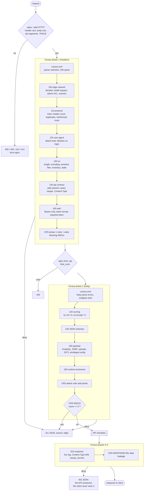

# Rule catalog

Every rule the lab adds on top of the OWASP CRS, in the order Coraza evaluates them. The "Test" column is the case name in `tests/waf-test.sh`; `make explain-allinone CASE=<name>` shows the rules that actually fired for it.

Conventions:

- IDs 10000-19999 are the lab's (1-99999 is the range reserved for local rules; CRS uses 900000-999999 and CRS plugins 9500000-9999999).
- `deny` rules are hard policy and block alone. Scoring rules add to the CRS anomaly score and let CRS rule 949110 decide.
- Every rule carries `msg`, `severity` and a `lab/...` tag, so the audit log is readable without opening the rule file.

## How a request is evaluated

## coraza.conf (engine)

| ID | Phase | Action | What and why |
| --- | --- | --- | --- |
| 200000 | 1 | parser | XML Content-Types use the XML body processor |
| 200001 | 1 | parser | `application/json` uses the JSON body processor, so fields become `ARGS:json.*` |
| 200006 | 1 | parser | `application/*+json` uses the JSON body processor |
| 200007 | 1 | parser | `application/octet-stream` and `text/plain` use RAW (otherwise Coraza parses them as urlencoded garbage) |
| 200009 | 1 | deny 400 | URI that fails to parse |
| 200002 | 2 | deny 400 | Body the parser could not read (broken JSON, nesting above 32) |
| 200003 | 2 | deny 400 | Multipart strict validation failure |
| 200004/5 | 1/2 | deny 400 | `SecArgumentsLimit` (500) reached |

## rules-before/100-edge-network.conf

| ID | Phase | Action | What and why | Test |
| --- | --- | --- | --- | --- |
| 10000 | 1 | deny 403 | Client IP in `data/ip-denylist.txt` | `ip-denylist` |
| 10010 | 1 | engine off | `GET/HEAD /health` and `/ready` without query skip the WAF (probes must never be blocked) | `health` |
| 10020 | 1 | deny 403 | `/admin`, `/internal`, `/metrics`, `/lab/calls` only from `data/admin-networks.txt` | `admin-from-internet`, `admin-from-vpn` |
| 10030 | 1 | DetectionOnly | Trusted scanner IPs: inspected and logged, never blocked | `trusted-scanner-sqli` |

## rules-before/110-protocol.conf

| ID | Phase | Action | What and why | Test |
| --- | --- | --- | --- | --- |
| 10100 | 1 | deny 400 | Host header not served by this API (Host header attacks) | `host-not-served` |
| 10110 | 1 | deny 400 | More than 40 request headers | `too-many-headers` |
| 10120 | 1 | deny 400 | Duplicated Content-Type, Authorization or Host (smuggling, parser confusion) | `duplicate-content-type` |
| 10130 | 1 | deny 405 | PUT/PATCH/DELETE outside the routes that accept them | `delete-on-reports` |

## rules-before/120-user-agent.conf

| ID | Phase | Action | What and why | Test |
| --- | --- | --- | --- | --- |
| 10200 | 1 | deny 403 | Attack tools not in the CRS list (`data/bad-user-agents.txt`) | `scanner-ffuf` |
| 10210 | 1 | deny 403 | Default HTTP-library User-Agent on the login route only | `library-on-login`, `library-elsewhere` |
| 10220 | 2 | +3 score | No User-Agent | `no-user-agent` |
| 10230 | 2 | +2 score | No Accept header | `no-accept`, `no-ua-no-accept` |

The scoring pair is phase 2 on purpose: CRS rule 901200 resets the anomaly scores in phase 1, after this file is loaded, so phase 1 points would be lost.

## rules-before/130-uri.conf

| ID | Phase | Action | What and why | Test |
| --- | --- | --- | --- | --- |
| 10300 | 1 | deny 414 | Raw URI above 2048 bytes | `uri-too-long` |
| 10310 | 1 | deny 400 | `%2f`, `%5c` or double encoding in the path | `encoded-slash` |
| 10320 | 1 | deny 404 | Sensitive files: VCS, dotenv, backups, dumps, keys | `dotgit`, `backup-file` |
| 10330 | 1 | deny 404 | Route not in the API inventory (positive model) | `dotenv`, `not-in-inventory` |
| 10340 | 1 | deny 404 | `/static/` name not in the allowlist | `static-not-allowed` |

The three 404 rules force `ctl:auditEngine=On`: 404 is excluded from `SecAuditLogRelevantStatus`, and WAF decisions must still be audited.

## rules-before/140-api-contract.conf

| ID | Phase | Action | What and why | Test |
| --- | --- | --- | --- | --- |
| 10400 | 1 | deny 400 | `@restpath /api/v1/users/{id}`: id must be a positive integer | `user-id-not-numeric`, `user-id-sqli` |
| 10401 | 1 | deny 400 | `@restpath /api/v1/tickets/{id}`: same | |
| 10402 | 1 | deny 400 | `@restpath /api/v1/reports/{id}/download`: id is `rep-NNN` | `report-id-format` |
| 10403 | 1 | deny 400 | `@restpath /lab/status/{code}`: three-digit status | `status-code-format` |
| 10410 | 1 | deny 400 | Search `q` longer than 100 characters | `search-q-too-long` |
| 10411 | 1 | deny 400 | Search `limit` not in 1..50 | `search-limit-range` |
| 10420 | 1 | deny 400 | `/lab/slow?ms=` above 2000 (business-logic DoS) | `slow-above-cap` |
| 10421 | 1 | deny 400 | `/lab/large?bytes=` above 262144 (amplification) | `large-above-cap` |
| 10430 | 1 | deny 415 | JSON routes without `application/json` | `json-route-wrong-ct` |
| 10431 | 1 | deny 415 | Feedback form without urlencoded | `form-route-wrong-ct` |
| 10432 | 1 | deny 415 | Upload without multipart or octet-stream | `upload-wrong-ct` |
| 10440 | 2 | deny 400 | `POST /api/v1/users` body vs `schemas/user-create.json` (mass assignment) | `mass-assignment`, `role-not-in-enum` |
| 10441 | 2 | deny 400 | `POST /api/v1/tickets` body vs `schemas/ticket-create.json` | `ticket-too-many-tags` |
| 10442 | 2 | deny 400 | `POST /api/v1/auth/login` body vs `schemas/login.json` | `login-extra-field` |

## rules-before/150-auth.conf

| ID | Phase | Action | What and why | Test |
| --- | --- | --- | --- | --- |
| 10500 | 1 | deny 401 | Authorization scheme other than Bearer | `basic-auth` |
| 10510 | 1 | deny 401 | Malformed Bearer token (RFC 6750 alphabet, 16..512 chars); logs only the length | `bearer-malformed` |
| 10520 | 1 | deny 401 | `/api/v1/auth/me` and `/logout` without Authorization | `me-without-token` |
| 10530 | 1 | ctl | Drops the request body from the audit record of the login route (passwords) | |

## rules-before/160-payload.conf

| ID | Phase | Action | What and why | Test |
| --- | --- | --- | --- | --- |
| 10600 | 2 | deny 403 | GraphQL introspection (`__schema`, `__type`) | `graphql-introspection` |
| 10610 | 2 | deny 403 | GraphQL alias batching (more than 20 `name: field` pairs) | `graphql-aliases` |
| 10620 | 2 | deny 403 | SSRF: internal or non-HTTP URLs in webhook and admin config arguments | `ssrf-private`, `ssrf-metadata` |
| 10630 | 2 | deny 403 | Upload with an executable or script extension | `upload-php` |
| 10640 | 2 | deny 403 | Template injection syntax in ticket and feedback text | `ssti-ticket` |
| 10650 | 2 | deny 403 | Privilege fields (`role`, `is_admin`...) in `/admin/config` | `admin-config-role` |

## rules-before/190-runtime-exclusions.conf

| ID | Phase | Action | What and why | Test |
| --- | --- | --- | --- | --- |
| 10900 | 1 | ctl | `Expect: 100-continue` on upload and webhook routes is not a restricted header for CRS 920450 (false positive found by the test suite) | `body-1.5m-api` |
| 10910 | 1 | ctl | `GET /openapi.json` skips the canary DLP rule 19100: the public spec documents the canary string (false positive found when importing the spec into an API client) | `openapi-spec` |

## rules-after/900-config-exclusions.conf

| Directive | What and why |
| --- | --- |
| `SecRuleRemoveById 9524139` | Workaround for a Coraza v3.8.1 crash: `setvar:'!tx.1'` in the referer-hardening plugin aborted the nginx worker on any request with a Referer header (`referer`, `referer-invalid`) |

## rules-after/910-response.conf

| ID | Phase | Action | What and why | Test |
| --- | --- | --- | --- | --- |
| 19100 | 4 | deny 403 | Canary marker `LAB_RESPONSE_MARKER_7f3a` in a response body (DLP) | `canary-in-body` |
| 19110 | 3 | log | Same canary in a response header (detection-only pattern) | `canary-in-body` |
| 19120 | 4 | deny 403 | Private keys or AWS access key ids in a response body | `secret-in-body` |
| 19130 | 3 | log | Backend 5xx (observability) | `backend-503` |
| 19140 | 3 | log | Non-JSON response on an `/api/v1` route | |

## CRS and plugin rules exercised by the tests

| Rule | Class | Test |
| --- | --- | --- |
| 911100 | Method not in `tx.allowed_methods` | `method-propfind` |
| 913100 | Scanner User-Agent | `scanner-sqlmap` |
| 920430 | HTTP version not allowed (HTTP/1.0) | `http-1.0` |
| 930xxx | Path traversal / LFI | `crs-lfi-arg` |
| 932xxx | Remote command execution | `crs-rce` |
| 934130 | JavaScript prototype pollution | `crs-proto-pollution` |
| 941xxx | XSS | `crs-xss` |
| 942xxx | SQL injection (libinjection and regex) | `crs-sqli` |
| 944xxx | Java / Log4Shell | `crs-log4shell` |
| 9524110 | Invalid Referer (referer-hardening plugin) | `referer-invalid` |
| 949110/949111 | Inbound anomaly score over the threshold | every CRS case |
